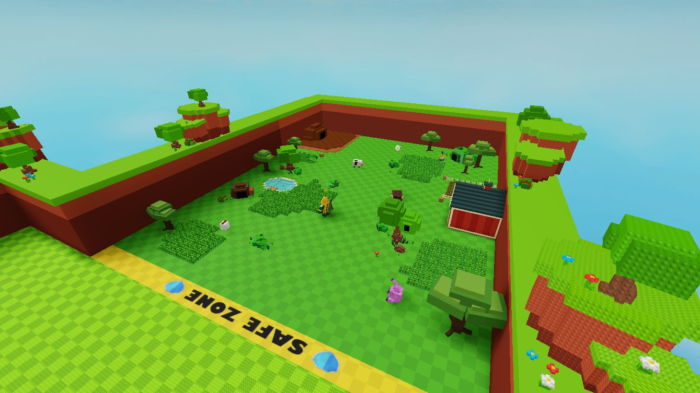

# Grasslands creature implementation and review

Issues [#3](https://github.com/dmikkelsen04/grasslands-class-project/issues/3), [#4](https://github.com/dmikkelsen04/grasslands-class-project/issues/4), and [#5](https://github.com/dmikkelsen04/grasslands-class-project/issues/5), implemented November 23, 2026 with AI assistance. Peer approval remains required. This work builds on the map in PR #11; no original cloud place is changed or published.

## Delivered behavior

The server creates one of each of the eight existing grasslands species, for a shared cap of eight creatures regardless of player count. They alternate between idle and short walks around their home areas. Footprint clearance, continuous grass-floor support, swept collision checks, zone boundaries, and creature separation keep roaming away from the recessed pond, barn, cliffs, spawn area, and occupied spaces. Blocked walks return to idle and choose another destination.

Removing a creature schedules a replacement after five seconds. Service Start is idempotent; Stop disconnects its update connection and removes the population. The server-only Despawn hook rejects an already removed creature. Catching, rarity-weighted encounters, collection UI, persistence, and shiny variants are not implemented by these issues.

| Stable species ID | Display name | Rig joints |
| --- | --- | --- |
| Chicken | Angry Chicken | 11 |
| WaddleDuck | Waddle Duckling | 12 |
| GrumpyBison | Grumpy Bison | 19 |
| MoodyCow | Moody Cow | 19 |
| BouncyPig | Bouncy Pig | 12 |
| WoolballSheep | Woolball | 12 |
| Scarecrow | Living Scarecrow | 15 |
| CornfedColossus | Corn Colossus | 30 |

## Reused assets and new code

The eight models and their 16 idle/walk clips come from the owner-provided Catch a Shiny snapshot of November 23, 2026. Geometry, rig joints, welds, original dimensions, and authored animation poses are prior work. Existing animation playback and gameplay scripts are not imported. The class-project code for spawning, movement validation, lifecycle, and animation playback is new.

`assets/manifest.json` records provenance and source clip identifiers. These identifiers refer to the original local animation library, not uploaded Roblox animation IDs. The exported clips contain numeric pose data in StringValues, so they work in this unpublished class build without uploading or granting access to new animation assets. Existing referenced visual assets retain their original permissions.

Models are stored in ServerStorage.CreatureAssets with the original named Motor6D hierarchy and a primary root normalized to the origin. Only that root is anchored; all parts are non-colliding and non-touching. Original ImportGroundOffset/Width/Depth/Height attributes supply placement and clearance. Do not rename joint parts without updating the matching clips.

`CreatureCatalog` provides stable IDs, display names, rarities, and home locations for later features. `CreatureService` owns the population and authoritative positions; clients cannot spawn/despawn through a remote. Each client applies the embedded poses through Motor6D.Transform in PreSimulation using a shared server-clock state timestamp, with a short idle/walk crossfade. There is one client update connection, and removed models release their animation controllers/joint references. The local AnimationReady attribute is a test diagnostic, not trusted server state.

## Build and validation

Normal builds need only the pinned Rojo/StyLua tools:

```powershell
powershell -NoProfile -ExecutionPolicy Bypass -File tools/check.ps1
python tests/map_structure.py build/grasslands.rbxlx
python tests/creature_assets.py build/grasslands.rbxlx
```

CI runs formatting/parsing, the clean place build, map checks, and creature asset checks. The creature checks confirm exactly eight connected rigs, one anchored root per rig, no embedded scripts/interactions, and 16 matching non-static clips containing 41,971 finite poses. The map's 14,658 anchored scenery parts still pass its existing checks. CI does not launch Roblox or claim gameplay coverage percentages.

Studio checks on the class build confirmed all eight species render, move, and animate without project-script errors. Installed MapGeneratorPlugin/Animation Spoofer messages are unrelated local plugins, not packaged project scripts. Two actual simulated clients confirmed the shared cap, movement and idle/walk transitions for every species, local animation changes on all eight, obstacle/pond/spawn rejection, removal and replacement, and stop/restart cleanup. The test result is recorded in `docs/evidence/creature-test-result.json`.

An initial randomized 30-second observation did not observe Chicken satisfying both movement/state conditions; the next run passed. The repeatable test now observes at least 30 seconds and allows up to 60 seconds for all randomized transitions, rather than assuming every route completes within a fixed short window. It still requires movement and both states for every species.

## Repeat the two-client test

With Lune 0.10.5 available, build the normal place, then run `lune run tools/build-creature-test`. Open `build/grasslands-creature-test.rbxlx` in Studio. From the edit-mode Command Bar run:

```lua
local result = game:GetService("StudioTestService"):ExecuteMultiplayerTestAsync(2, "CreatureIntegration")
print(game:GetService("HttpService"):JSONEncode(result))
```

The test launches two clients and ends itself with an `ok` result. Startup allows 40 seconds for both clients; movement is observed for 30–60 seconds before lifecycle checks. Both clients report visible joint changes and cleanup. The test scripts and report remote exist only in this separate harness, never in the normal build. Use the normal place for the class demo.

For a visual walkthrough, press Play in the normal build, walk from spawn into the meadow, and inspect each species idle and moving. Check the barn and pond approaches and watch creatures turn back from obstacles. Review at least one idle/walk transition per species. The movement implementation uses short straight walks with obstacle rejection, not long-distance navigation around obstacles. Large-scale population/performance testing is outside this eight-creature implementation.

Optional re-extraction: `lune run tools/import-creatures path/to/source.rbxl`. This needs the private owner-provided snapshot; ordinary builds use the committed assets and do not need the original game.

## Review evidence



Review asset provenance, new gameplay code, test results, and a fresh Studio build before approval. These issues remain open until the reviewed implementation is merged.
