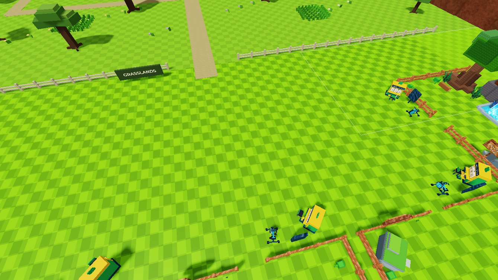

# Issue #2: grasslands map review

Implemented on `feature/2-grasslands-map`, 2026-11-23. This is implementation/test evidence, not a claim of peer approval or a completed sprint. Issue #2 remains open until the reviewed PR merges.

Layout authoring and automated Studio checks were performed with AI assistance. Human peer review remains required.

## Delivered map

- One spawn area with the original five static plot shells.
- A new 480 x 500 stud grasslands zone (240,000 square studs), adjoining the spawn without a ground gap.
- A central entrance, looping walking paths, barn/cornfield corner, shallow decorative pond/boardwalk, trees, flowers, and non-colliding grass patches.
- Three named, invisible future creature areas: SunMeadow, PondMeadow, and NorthMeadow.
- Four continuous perimeter collision walls with visible stepped grass-topped cliffs.
- One neutral, enabled spawn. Every map part is anchored; no legacy gameplay scripts, prompts, or remotes are embedded in the map.

Only scenery is implemented. Plot shells do not claim players, generate income, or interact. The pond is deliberately shallow/walkable; swimming is outside this issue. Creatures, catching, and the collection UI remain separate issues.

## Provenance and reproduction

The owner requested using the place open in Studio: Catch a Shiny, place ID 114451084618400. A local snapshot was downloaded before extraction. The original cloud place was not changed or published. Script-free visual templates were extracted, then placed into a new layout rather than importing old gameplay or the complete old map. See `assets/manifest.json`.

`world/grasslands/GrasslandsMap.rbxmx` is the source consumed by Rojo. A clean `rojo build default.project.json --output build/grasslands.rbxlx` reproduces the map without the original game or the extraction snapshot. Optional layout regeneration uses Lune **0.10.5** and `lune run tools/generate-map` from the repository root. Standard builds do not require Lune. Regenerate before building after editing the authoring script; Studio-only edits are not automatically exported back into it.

## Validation performed

Tested the newly built local place in Studio, not the original game. A fresh character spawned with 100 health, supported by the intended SpawnLocation. The automated navigation walkthrough completed these routes:

1. Spawn to the entrance/main trail at (-15, -150).
2. Entrance to the pond boardwalk approach at (-125, -260).
3. Pond to the barn approach at (100, -395).
4. Barn to the north meadow at (75, -530).

Coordinates above are X/Z in studs. The standard humanoid pathfinding agent independently found routes from spawn to all three creature areas and the barn approach (47, 88, 129, and 102 waypoints respectively).

For boundary tests, the character was repositioned near each side, walked toward the outside, and attempted a jump. All four tests retained 100 health and stayed inside:

| Side | Allowed edge | Observed stop coordinate | Result |
| --- | --- | --- | --- |
| West | X >= -255 | X = -254.40 | Contained |
| East | X <= 225 | X = 224.40 | Contained |
| North | Z >= -575 | Z = -572.40 | Contained |
| South | Z <= 135 | Z = 134.40 | Contained |

`tests/map_structure.py` passed on the clean Rojo output: 5,060 anchored map parts, exactly one safe spawn, continuous foundations, four solid perimeter walls, and no embedded legacy gameplay. CI runs these assertions after the build. This does not claim comprehensive gameplay or performance coverage.

Studio Output showed the two expected project startup messages. An installed `MapGeneratorPlugin` emitted a `CreatePlugin` error, and other installed plugins logged play-mode notices. Those plugins are not part of this repository or the generated place. No project-script error was observed.

## Review evidence

The teammate should open the CI build artifact, repeat the walking/jumping checks, inspect asset provenance, and review the code/CI changes before approving. No Roblox publishing or automatic merge is part of this PR.
