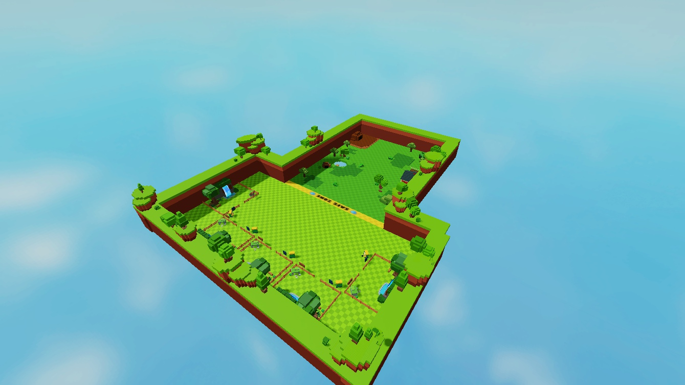

# Issue #2: grasslands map review

Implemented on `feature/2-grasslands-map`, 2026-11-23, with AI-assisted extraction and Studio validation. Peer review remains required; issue #2 closes only after the reviewed PR merges.

## Delivered map

The original spawn and grasslands are copied at unchanged scale and positions. The spawn floor is 343.25 x 181 studs; the grasslands floor spans approximately 205.75 x 250 studs, with the original pond cutout. The five plot shells, safe-zone stripe, farm, dense grass patches, den scenery, and original cliff walls retain their original appearance. All five bikes and the Munch Ball display (balls, pedestals, and labels) are removed. A copied original-style wall closes the far edge at Z=-337 where the other biomes were removed.

This is reused map/layout work, not a claim that these assets were created for class. Class changes are extraction, removing bikes and old gameplay interactions, packaging, closing the exit, and validation. Static plots and den scenery have no gameplay; creatures, catching, collection UI, and persistence are separate issues.

## Reproduction

Rojo consumes `world/grasslands/GrasslandsMap.rbxm`. Normal builds need neither the original game nor Lune. Optional regeneration with Lune 0.10.5: `lune run tools/generate-map`, then run `tools/check.ps1`. The packaged source scenery is `assets/environment/OriginalSpawnAndGrasslands.rbxm`. `tools/import-original-map.luau` documents the one-time extraction, taking a path to the original snapshot if re-extraction is needed. The full old game is not distributed. Studio edits do not automatically update these files.

## Validation

The freshly built `grasslands-original-size.rbxlx` was opened and playtested in Studio. A fresh character spawned at the original spawn with 100 health. Navigation succeeded from spawn to the entrance (-15,-140), pond approach (-51,-192), barn approach (48,-204), and back meadow (-15,-315), in X/Z studs. Pathfinding from spawn also succeeded for all four destinations (26, 41, 48, and 70 waypoints).

Walking and jumping toward perimeter walls stopped the character at X=-116.90 (west), X=87.15 (east), Z=-336.40 (north), and Z=105.40 (south), with 100 health. An initial south-boundary test teleported inside existing plot geometry and killed the character; repeating from a raycast-verified clear floor at (40,99) passed. This was a test placement correction; the original geometry was not moved.

The clean build passes `tests/map_structure.py`: 14,658 anchored parts, one enabled neutral spawn, original floor dimensions, connected entrance floors, solid end wall, five encounter patches, no bikes, and no legacy scripts/prompts/remotes in Workspace. StyLua formatting/parsing and Rojo build also pass. These checks do not claim comprehensive gameplay, performance, multiplayer, or device coverage.

## Review evidence

The teammate should open the CI build artifact, walk the original-size map, inspect the removed bikes and asset provenance, and review the changes before approval. No Roblox publishing or automatic merge is part of this PR.
